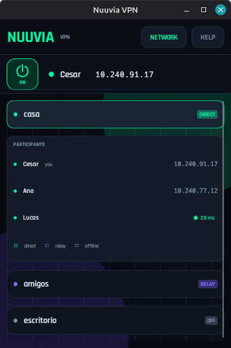
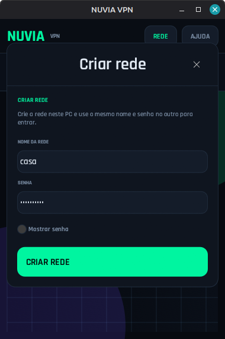
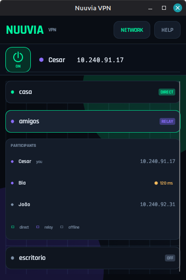
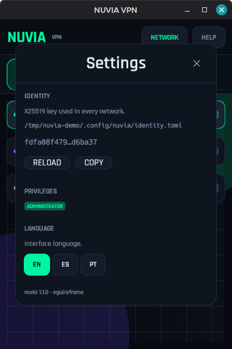
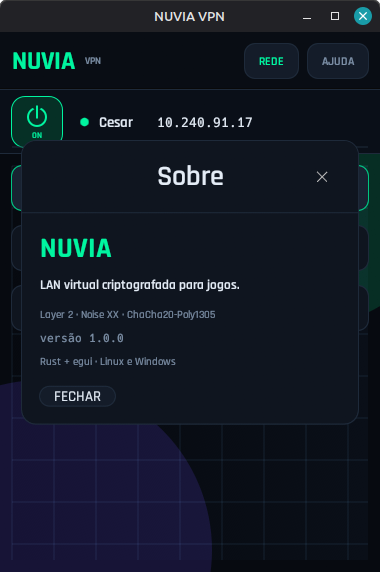

# Nuuvia

**English** | [Português](README.pt-BR.md)

Encrypted virtual LAN for games. The goal is to open a game, host a LAN match,
and have the other computer see the room as if both were on the same cable —
including **broadcast** and **multicast** discovery.

> Status: **1.2.0**. Minecraft Java 1.8.5 works Linux ↔ Windows on the LAN and
> **across different networks** through the encrypted relay on the Oracle VPS in
> São Paulo. The compact egui GUI supports multiple rooms, a single TAP/IP per
> machine, 2–8-peer mesh with direct or relay paths, per-participant status, a
> persisted room list, and close-to-tray.

> The product name is **Nuuvia**. Internal identifiers, binaries (`nuvia`,
> `nuvia-gui`), packages, configuration paths, and TAP names keep the original
> `nuvia` spelling for compatibility with existing installs.

## Demo

<p align="center">
  
</p>

<p align="center">
  
  
  
  
</p>

## What already works

- **Layer 2 TAP** interface (`tun-rs`), with a shared hub in the GUI.
- **Noise XX** handshake authenticating static keys in 1:1 mode (CLI).
- **2–8-peer mesh** in the GUI over relay and direct paths, with a per-room
  group key.
- **ChaCha20-Poly1305** encryption with explicit counters, AAD, and a 64-packet
  replay window (out-of-order UDP is accepted).
- Traffic keys derived from the handshake + random seeds + the room PSK.
- Ping/ARP/ICMP crossing the tunnel in both directions.
- Ethernet broadcast flooding (tested with `10.240.0.255`).
- Discovery routes `224.0.0.0/4`, `224.0.2.60/32` (Minecraft), and
  `255.255.255.255/32` through the TAP, with automatic cleanup on exit.
- Minecraft multicast (`224.0.2.60:4445`) and global broadcast validated in the
  integration test.
- **Minecraft Java 1.8.5 playable Linux ↔ Windows** over the virtual IP: a world
  opened on Windows appears on Linux, and the multicast announcement was
  captured on `nuvia-vpn0`.
- **Internet mode (M5a)**: rendezvous, public endpoint discovery, and direct
  handshake between peers.
- **Relay (M5b)**: when one side is behind CGNAT/symmetric NAT (mobile,
  4G/5G), the already-encrypted L2 packets are forwarded by the VPS; validated
  with Windows on a hotspot and Linux at home, ~50 ms ping, and Minecraft LAN
  working.
- **Compact multi-room GUI (egui/eframe)** for Linux and Windows:
  - **REDE** (Network) menu at the top with **CRIAR REDE** and **ENTRAR EM
    REDE**;
  - **AJUDA** (Help) menu with **Ajustes** and **Sobre**;
  - entry by **room name + password**, with no invite and no server URL;
  - **one TAP and one IP** for all rooms (compact L2 VPN);
  - each room has its own UDP port, mesh session, and group key;
  - all rooms stay active at the same time; the shared TAP delivers discovery
    for all of them to Minecraft;
  - bar with an **ON/OFF** button, status dot, user, and TAP IP;
  - **2–8 participants per room**, trying direct and relay paths in parallel;
    the server is fixed at compile time;
  - **per-participant status**: green = direct, purple = relay, gray =
    offline/waiting;
  - hover a participant to see a **quality dot and the measured ping**;
  - right-click a participant to **copy their IP**;
  - **English, Spanish, and Portuguese UI**, selectable in Settings.
- Keepalive, dead-session detection, and automatic reconnection.
- Integration test with two network namespaces, no sudo when user namespaces
  are available.

## M3 acceptance (2026-11-16)

Windows hosted Minecraft Java 1.8.5 with **Open to LAN**, and Linux saw and
joined the world through the virtual IP. The discovery announcement was
captured on the TAP:

```
15:18:12.639224 00:ff:c8:62:5f:96 > 01:00:5e:00:02:3c, ethertype IPv4
  10.240.0.2.55625 > 224.0.2.60.4445: UDP, length 45
```

- `01:00:5e:00:02:3c` is the multicast MAC for `224.0.2.60`.
- `10.240.0.2` is the Windows virtual IP; Linux was `10.240.0.1`.
- The Linux client had port `4445` and group `224.0.2.60` on `nuvia-vpn0`.
- On Windows, `Set-NetIPInterface -InterfaceMetric 1` was required on the TAP;
  without it, the physical Ethernet won the multicast selection.

## Why Layer 2

Games announce rooms with UDP broadcast (`255.255.255.255`) or multicast
(Minecraft Java uses `224.0.2.60:4445`). Multicast usually leaves with **TTL
1**, and an L3 VPN (WireGuard/Tailscale) routes and drops it. Commercial L2
VPNs work because they deliver a single broadcast domain. That is exactly what
Nuuvia does: a virtual Ethernet switch over encrypted UDP.

## GUI (Linux and Windows)

The GUI is the recommended path. It opens in a small window (380×540) and does
not ask for a server, path, TAP, port, role, or IP.

1. Open `nuvia-gui` as administrator.
2. **REDE** menu → **CRIAR REDE** on the first PC.
3. Type a room name and a password; confirm.
4. On the other PC, **REDE** menu → **ENTRAR EM REDE** with the **same name**
   and **same password**.

The first peer creates the room on the server; the others join with the same
name and password. The GUI supports up to 8 participants per room and several
rooms at once, all on the same local TAP/IP. To play:

1. Keep the room connected.
2. Open the game **after** Nuuvia and use **Open to LAN**.
3. On the other PC, the world should appear in the LAN list.

Discovery routes are installed **once on the shared TAP** and cover every
connected room; there is no need to activate one room at a time. The **ON/OFF**
button in the bar connects or disconnects the selected room without removing it
from the list.

The top bar shows **one TAP IP**, the same for all rooms. Each card is a compact
line with a title and badge; **click the card** to expand that room's participant
list below. Because the TAP is shared, Minecraft sees the LANs of all active
rooms; rooms are not isolated locally. Right-click the card: **DESATIVAR**
disconnects that room; **SAIR** removes it from the list.

The **AJUDA** menu contains **Ajustes** (identity, fixed server, privileges, and
language), **Sobre**, and **Sair**. The interface can be switched between
English, Español, and Português in **Ajustes → Idioma**.

Rooms are saved in `rooms.toml` (in the same directory as the identity) and
restored on startup without connecting automatically. When you close the
window, Nuuvia keeps running in the **system tray**; click the icon to restore
the window or use **Sair** from the tray/AJUDA menu. If the environment has no
tray (StatusNotifier), closing exits normally.

On Linux, the GUI needs root/CAP_NET_ADMIN to create the TAP and install routes:

```bash
cargo build --release -p nuvia-gui
sudo ./target/release/nuvia-gui
```

If it starts without root, **Ajustes → Reabrir como admin** uses `pkexec`. On
Windows, the `requireAdministrator` manifest requests UAC.

### Server and path

The server is fixed at compile time:

```
https://167.234.237.6.sslip.io
```

To point to another server, rebuild with
`NUVIA_SERVER_URL=https://your-server cargo build --release -p nuvia-gui`.
There is no URL field in the interface.

The GUI sends mesh frames to the peers' endpoints **and** through the relay. In
addition to the public endpoint, each peer advertises its local IPs to the
server; this lets two machines on the same LAN take a direct path even when the
router does not support NAT hairpinning. Each participant in the expanded list
has a status dot: green = direct path, purple = relay, gray =
offline/waiting. The card badge summarizes the room: `DIRETO` only when every
active participant is direct; otherwise, after 8 s, `RELAY`. The CLI keeps the
1:1 AUTO mode (direct → relay).

## CLI quick start (advanced)

The GUI hides the details. The `nuvia` CLI remains available for manual LANs,
tests, and automation.

```bash
cargo build --release
```

On each machine, generate the identity and copy the public key:

```bash
./target/release/nuvia keygen --name pc-a
./target/release/nuvia pubkey
```

### Internet (no invite)

The relay token and virtual IP are derived from the room name/password, just
like the GUI. Pass `--room` and `--server`; `--ip` is optional.

```bash
# peer A
sudo ./target/release/nuvia up \
  --room home --password 'change-this-password' \
  --server https://167.234.237.6.sslip.io

# peer B (same name and password)
sudo ./target/release/nuvia up \
  --room home --password 'change-this-password' \
  --server https://167.234.237.6.sslip.io
```

The lower `public_key` gets `.1` and the higher one gets `.2`, inside
`10.240.<room-octet>.0/24`. Use `--ip 10.240.x.y/24` to force another address
and `--room-token` to use a standalone token. `--relay` forces the VPS;
`--direct` forces P2P only. Without `--relay`/`--direct`, the CLI uses AUTO.

### Manual LAN

On machine A (physical IP `192.168.1.10`):

```bash
sudo ./target/release/nuvia --identity "$HOME/.config/nuvia/identity.toml" up \
  --room home --password 'change-this-password' \
  --tap-name nuvia-vpn0 --ip 10.240.0.1/24 \
  --bind 0.0.0.0:42424 \
  --peer <PUB_B>@192.168.1.20:42424
```

On machine B (physical IP `192.168.1.20`), change the IP to `10.240.0.2/24`
and the peer to `<PUB_A>@192.168.1.10:42424`.

> `sudo` usually changes `HOME` to `/root`. Without `--identity`, Nuuvia would
> create a new identity in `/root/.config/nuvia` and the public key would not
> match the other side.

If **UFW** is active (default `DROP` on LMDE), allow the tunnel and the TAP:

```bash
sudo ufw allow 42424/udp
sudo ufw allow in on nuvia-vpn0
```

Test with `ping 10.240.0.2` on machine A and `ping 10.240.0.1` on B. Both sides
must use the same room and password. The handshake initiator role is chosen
automatically from the public-key order; there is no `--listen` or `--dial`.

By default, the client installs `224.0.0.0/4`, `224.0.2.60/32` (Minecraft), and
`255.255.255.255` on the TAP so game discovery works. If this interferes with
Chromecast/printers on your network, use `--no-broadcast-routes`.

> `--password` on the command line appears in shell history and in `ps`. Prefer
> the GUI, which keeps the password in memory only.

## Windows (M1a)

The Windows x86_64 binary is built with:

```bash
rustup target add x86_64-pc-windows-gnu
cargo build --release --target x86_64-pc-windows-gnu
```

For convenience, `dist/windows/` contains `nuvia.exe`, `nuvia-gui.exe`,
`lanprobe.exe`, `install-tap.ps1`, the driver in `driver/amd64/`, and the
README.

Generated packages:

- `dist/nuvia-setup-x86_64.exe` — NSIS installer with the embedded driver,
  shortcuts, and uninstaller;
- `dist/nuvia-windows-x86_64.zip` — portable version with the same driver.

On the Windows PC:

1. Run `nuvia-setup-x86_64.exe` as administrator (recommended) or, with the
   zip, run `install-tap.ps1 -DriverDir .\driver` once.
2. Open `nuvia-gui.exe` and accept UAC.
3. **REDE** menu → **CRIAR REDE** or **ENTRAR EM REDE**.

The installer and binaries are not code-signed yet; SmartScreen may warn. The
Windows GUI uses wgpu/DirectX 12 (WARP as fallback), so it does not depend on
OpenGL 2.0. If it closes on startup or shows `os error 2`/`TAP unavailable`,
check `%APPDATA%\nuvia\nuvia.log`: the app tries to repair/rename the TAP
automatically and, if needed, runs the embedded `devcon`. The installer does
not reinstall the driver when it is already present.

### What Windows configures automatically

Nuuvia creates **one `nuvia0` adapter**, configures IP/MTU, installs the
discovery routes, sets the **interface metric to 1**, marks the TAP as a
**Private** network, and creates the `nuvia-nuvia0` firewall rule. Step by step
in [`deploy/windows/README.md`](deploy/windows/README.md) (in Portuguese).

Validated on a real Windows 11 machine with Minecraft Java 1.8.5.

## Linux packages

```bash
./scripts/build-linux-packages.sh
```

Generates:

- `dist/nuvia_1.2.0_amd64.deb` — installs `/usr/bin/nuvia-gui`,
  `/usr/bin/nuvia`, `/usr/bin/lanprobe`, the shortcut, and the icons. The
  launcher uses `pkexec` to ask for the password and create the TAP/routes;
- `dist/nuvia-1.2.0-x86_64.AppImage` — portable. `AppRun` copies the binary to
  an accessible path and calls `pkexec`; requires FUSE (`libfuse2`) or
  `APPIMAGE_EXTRACT_AND_RUN=1`.

Both keep the identity and room list in `~/.config/nuvia/`.

## Internet (M5a/M5b)

Internet mode uses a rendezvous server so peers can find each other. The server
sees only opaque IDs, public keys, endpoints, and the room token — **never** the
password or traffic keys. When the relay is used, it forwards the
already-encrypted L2 packets without being able to decrypt them.

On the server:

```bash
nuvia-server serve --config /etc/nuvia/server.toml
```

`nuvia invite` still exists to generate an invite with a random token
(compatibility), but the GUI does not use invites: the token is derived from
the password. Each peer starts with the same room name/password and receives a
different virtual IP. The default mode is **AUTO**: try the direct path for 8 s,
then fall back to the relay automatically.

> If a room was created earlier with a random invite, the server keeps the old
> token until it restarts. The GUI shows `403 invalid room token`; restart
> `nuvia-server` or use another room name. The server keeps rooms in memory
> only.

Local test of both paths (without a VPS):

```bash
./scripts/test-m5.sh                    # direct
NUVIA_TEST_RELAY=1 ./scripts/test-m5.sh # relay
```

The scripts start the server, a bridge, two namespaces, and ping through the
tunnel.

## Local test (no sudo)

```bash
./scripts/test-m0.sh
```

The script:

1. creates two network namespaces and a veth between them;
2. generates two identities;
3. starts a `nuvia` process in each namespace;
4. waits for the handshake;
5. pings from A to B and from B to A;
6. sends a broadcast to `10.240.0.255` and checks delivery;
7. validates the discovery routes and the `224.0.2.60:4445` multicast group;
8. sends a global `255.255.255.255` broadcast and checks delivery.

Expected output at the end:

```
M0/M3a OK: L2 tunnel, ARP/ICMP, broadcast, multicast and discovery routes work.
```

If user namespaces are blocked, run `sudo ./scripts/test-m0.sh`.

## Layout

```
nuvia/
├── crates/
│   ├── nuvia-core/       # identity, room, Noise, framing, session, tunnel
│   ├── nuvia-cli/        # `nuvia` binary (keygen, pubkey, up, doctor)
│   ├── nuvia-gui/        # multi-room egui/eframe GUI
│   ├── nuvia-protocol/   # HELLO/ACK, relay envelope, legacy invite
│   ├── nuvia-server/     # rendezvous + relay
│   └── nuvia-probe/      # `lanprobe` for broadcast/multicast
├── scripts/test-m0.sh    # network-namespace integration
├── scripts/test-m5.sh    # rendezvous/direct/relay with namespaces
├── scripts/build-linux-packages.sh   # .deb + AppImage
├── scripts/build-windows-package.sh  # zip + NSIS installer
├── scripts/make-icon.py              # shared icon
├── docs/architecture.md  # full design up to the relay
├── deploy/oracle/        # VPS, systemd, Caddy, UFW
├── deploy/windows/       # Windows client instructions
├── dist/                 # generated packages (not versioned)
├── Cargo.toml
└── LICENSE
```

## Roadmap

| Milestone | Delivery |
|---|---|
| **M0** ✅ | Linux L2 tunnel, Noise + AEAD, ping, broadcast, netns test |
| **M1a** ✅ | Windows CLI validated: TAP, routes, firewall, metric, and ping |
| **M1b** ✅ | Compact multi-room GUI, persisted list, and tray |
| **M2** ✅ | 2–8 mesh GUI, per-peer status, shared TAP/IP, and direct path |
| **M3a** ✅ | `224.0.0.0/4`, `224.0.2.60/32`, and `255.255.255.255` routes via TAP |
| **M3** ✅ | Minecraft Java 1.8.5 LAN Linux ↔ Windows, multicast announcement on TAP |
| **M4** ✅ | NSIS/.deb/AppImage installers, icons, and tray; signing/autostart in M6 |
| **M5a** ✅ | Rendezvous, endpoint discovery, and direct handshake |
| **M5b** ✅ | Encrypted UDP relay for symmetric NAT (local test + VPS) |
| **M5** ✅ | Minecraft across different networks via relay (Windows on hotspot) |
| **M6** | TCP/TLS fallback, multiple relays, peer relay, `nuvia send`, IPv6 |

Architecture, protocol, and relay details in
[`docs/architecture.md`](docs/architecture.md) (in Portuguese).

## Security

- The private identity lives in `~/.config/nuvia/identity.toml` with mode
  `0600`.
- The room password is never transmitted: it becomes a PSK via Argon2id
  (19 MiB, 2 iterations). The relay only sees ciphertext.
- The Noise XX handshake authenticates static keys. The peer public key is
  verified against the configured one; a different key aborts the connection.
- Each direction has its own key and counter; replays and old packets are
  discarded.
- **Warning:** the relay token is derived from the PSK (`BLAKE3(PSK)[..16]`) to
  allow joining without an invite. Whoever controls the server knows that token
  and can try to guess the password offline, with Argon2id per attempt. Use a
  long password; traffic remains protected by the PSK anyway.
- In the mesh, all members share the group key derived from the password. Any
  room member can inject L2 frames (as on a physical LAN); the server still
  cannot decrypt them.
- The GUI merges frames from all rooms into the local TAP; a world announced in
  one room may appear in another room's list. This is intentional to keep
  several rooms active with a single adapter.
- The Oracle VPS SSH key is **not** in the repository: it lives in
  `~/.ssh/nuvia/ssh-key-2026-11-16.key` (mode 600). `.gitignore` blocks
  `*.key`, `*.pem`, and `.env*`.
- The room list lives in `rooms.toml` with mode `0600` and contains each room
  password in plain text, required for reconnecting. Protect the file.

## Current limitations

- The GUI uses **one shared TAP/IP and mesh** for all rooms (2–8 peers per
  room), trying direct and relay in parallel. The CLI remains 1:1 with Noise and
  AUTO direct/relay; the two modes do not interoperate in the same session.
- All GUI rooms share the same local L2 domain; separation is provided by the
  group keys at the relay, not by IP.
- GUI ready on Linux/Windows, with a persisted list and tray; the tray depends
  on StatusNotifier on Linux. Without it, closing exits the tunnels.
- No service/autostart on clients yet (M6).
- `AUTO` falls back to the relay after 8 s; the CLI can force
  `--relay`/`--direct`.
- The relay adds ~50 ms in the São Paulo ↔ mobile test and still has no
  per-room bandwidth cap.
- MTU is fixed at 1360; there is no fragmentation inside the tunnel.
- The CLI and GUI only meet in the same room when both use the name/password
  (derived token). Legacy invites do not interoperate with the GUI.
- Multiple simultaneous rooms share the same fixed server and the same TAP;
  the `224.0.0.0/4`, `224.0.2.60/32`, and `255.255.255.255/32` routes are
  installed once and cover every connected room.
