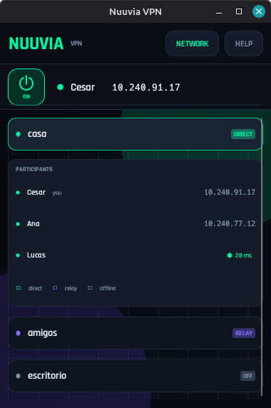
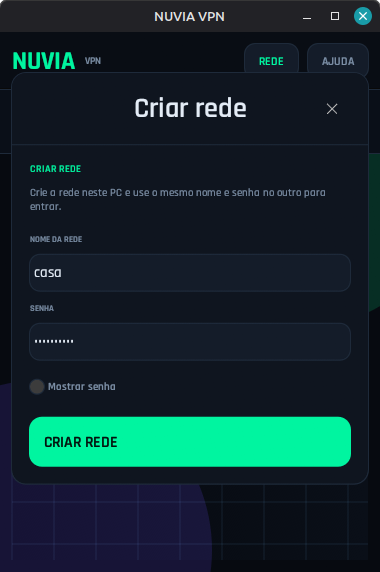
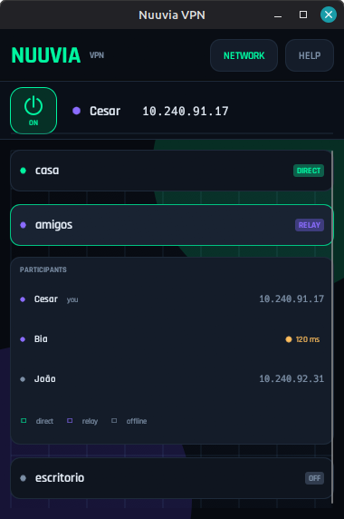
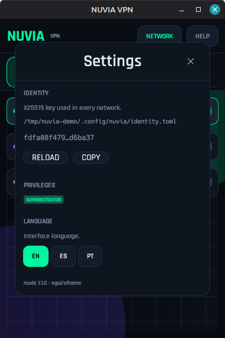
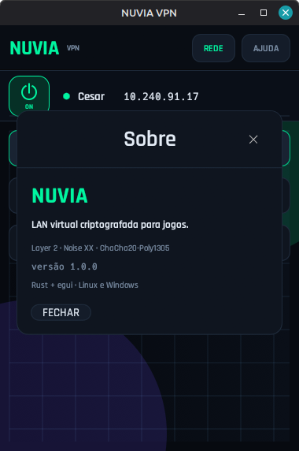

# Nuuvia

[English](README.md) | **Português** · [Site](https://nuuvia.devcesar.com/) · [](https://buymeacoffee.com/cesarzxk)

[Política de assinatura de código](CODE_SIGNING.md) · [Privacidade](PRIVACY.md) · [Segurança](SECURITY.md)

LAN virtual criptografada para jogos. O objetivo é abrir um jogo, hospedar uma
partida em LAN e o outro computador enxergar a sala como se estivesse no mesmo
cabo — inclusive descoberta por **broadcast** e **multicast**.

> Status: **1.5.0**. O Minecraft Java 1.8.5 funciona Linux ↔ Windows na LAN e
> **entre redes diferentes** via relay cifrado na VPS Oracle em São Paulo. A GUI
> compacta (egui) tem múltiplas redes, um único TAP/IP por máquina, mesh 2–8
> com caminho direto ou relay, status por participante, firewall por rede com
> importação de portas de apps, descoberta de redes públicas, lista de redes
> persistida e fechar para a bandeja (tray).

> O nome do produto é **Nuuvia**. Identificadores internos, binários (`nuvia`,
> `nuvia-gui`), pacotes, caminhos de configuração e nomes de TAP mantêm a grafia
> original `nuvia` para compatibilidade com instalações existentes.

## Demonstração

<p align="center">
  
</p>

<p align="center">
  
  
  
  
</p>

## O que já funciona

- Interface **TAP Layer 2** (`tun-rs`), com hub compartilhado na GUI.
- Handshake **Noise XX** autenticando as chaves estáticas no modo 1:1 (CLI).
- **Mesh 2–8 peers** na GUI via relay e caminho direto, com chave de grupo por
  sala.
- Criptografia **ChaCha20-Poly1305** com contador explícito, AAD e janela de
  replay de 64 pacotes (UDP fora de ordem é aceito).
- Chaves de tráfego derivadas do handshake + sementes aleatórias + PSK da sala.
- Ping/ARP/ICMP atravessando o túnel nos dois sentidos.
- Flood de broadcast Ethernet (testado com `10.240.0.255`).
- Rotas de descoberta `224.0.0.0/4`, `224.0.2.60/32` (Minecraft) e
  `255.255.255.255/32` pelo TAP, com limpeza automática ao encerrar.
- Multicast de Minecraft (`224.0.2.60:4445`) e broadcast global validados no
  teste de integração.
- **Minecraft Java 1.8.5 jogável Linux ↔ Windows** pelo IP virtual: o mundo
  aberto no Windows aparece no Linux e o anúncio multicast foi capturado no
  `nuvia-vpn0`.
- **Modo internet (M5a)**: rendezvous, descoberta de endpoint público e
  handshake direto entre peers.
- **Relay M5b**: quando um lado está atrás de CGNAT/NAT simétrico (celular,
  4G/5G), os pacotes L2 já cifrados são encaminhados pela VPS; validado com
  Windows no hotspot e Linux em casa, ping ~50 ms e Minecraft LAN funcionando.
- **GUI compacta multi-rede (egui/eframe)** para Linux e Windows:
  - menu **REDE** no topo com **CRIAR REDE** e **ENTRAR EM REDE**;
  - menu **AJUDA** com **Ajustes** e **Sobre**;
  - entrada por **nome da rede + senha**, sem convite e sem URL de servidor;
  - **um único TAP e um único IP** para todas as salas (VPN L2 compacta);
  - cada sala tem sua porta UDP, sessão mesh e chave de grupo;
  - todas as salas ficam ativas ao mesmo tempo; o TAP compartilhado
    entrega a descoberta de todas elas ao Minecraft;
  - barra com botão **ON/OFF**, bolinha de status, usuário e IP do TAP;
  - **mesh de 2 a 8 participantes por sala**, tentando caminho direto e
    relay em paralelo; servidor fixo na compilação;
  - **status por participante**: verde = direto, roxo = relay, cinza =
    offline/aguardando;
  - passe o mouse sobre um participante para ver a **bolinha de qualidade e o
    ping medido**;
  - clique com o botão direito em um participante para **copiar o IP**;
  - **interface em inglês, espanhol e português**, selecionável nos Ajustes.
- Keepalive, detecção de sessão morta e reconexão automática.
- Teste de integração com dois network namespaces, sem sudo quando user
  namespaces estão disponíveis.

## Aceite M3 (16/11/2026)

O Windows hospedou Minecraft Java 1.8.5 com **Open to LAN** e o Linux viu e
entrou no mundo pelo IP virtual. O anúncio de descoberta foi capturado no TAP:

```
15:18:12.639224 00:ff:c8:62:5f:96 > 01:00:5e:00:02:3c, ethertype IPv4
  10.240.0.2.55625 > 224.0.2.60.4445: UDP, length 45
```

- `01:00:5e:00:02:3c` é o MAC multicast de `224.0.2.60`.
- `10.240.0.2` é o IP virtual do Windows; o Linux é `10.240.0.1`.
- O cliente Linux estava com a porta `4445` e o grupo `224.0.2.60` no
  `nuvia-vpn0`.
- No Windows foi necessário `Set-NetIPInterface -InterfaceMetric 1` no TAP;
  sem isso, a Ethernet física ganhava a escolha do multicast.

## Por que Layer 2

Jogos anunciam salas com UDP broadcast (`255.255.255.255`) ou multicast
(Minecraft Java usa `224.0.2.60:4445`). Multicast costuma sair com **TTL 1**, e
um VPN L3 (WireGuard/Tailscale) roteia e descarta. VPNs L2 comerciais
funcionam porque entregam um único domínio de broadcast. É exatamente isso que
o Nuuvia faz: um switch Ethernet virtual sobre UDP criptografado.

## GUI (Linux e Windows)

A GUI é o caminho recomendado. Ela abre em uma janela pequena (380×540) e não
pede servidor, caminho, TAP, porta, papel nem IP.

1. Abra o `nuvia-gui` como administrador.
2. Menu **REDE** → **CRIAR REDE** no primeiro PC.
3. Digite um nome de rede e uma senha; confirme.
4. No outro PC, menu **REDE** → **ENTRAR EM REDE** com o **mesmo nome** e a
   **mesma senha**. Entrar só aceita uma sala existente; nome ou senha errados
   mantêm o diálogo aberto e não adicionam a sala.

O primeiro peer cria a sala no servidor; os demais entram com o mesmo nome e
senha. A GUI suporta até 8 participantes por sala e várias salas ao mesmo
tempo, todas no mesmo TAP/IP local. Para jogar:

1. Deixe a rede conectada.
2. Abra o jogo **depois** do Nuuvia e use **Open to LAN**.
3. No outro PC, o mundo deve aparecer na lista de LAN.

As rotas de descoberta são instaladas **uma única vez no TAP compartilhado** e
cobrem todas as salas conectadas; não é preciso ativar uma rede por vez. O botão
**ON/OFF** da barra conecta ou desconecta a sala selecionada sem apagar a rede
da lista.

### Firewall por rede

Cada cartão de rede tem um item **FIREWALL** no menu de contexto e um selo
(`FW GLOBAL`, `FW JOGOS`, `FW BLOQUEAR`, `FW PERSONALIZADO`). A política filtra
tráfego IPv4 TCP/UDP/ICMP entre este PC e os peers daquela rede:

- **TUDO** — sem filtro.
- **JOGOS** — descoberta LAN e portas comuns de jogos (Minecraft 4445/25565,
  Bedrock 19132–19133, Source/Steam 27015–27036, Xbox 3074, PSN 3478–3480,
  mDNS/SSDP e ICMP).
- **BLOQUEAR** — descarta todo o tráfego IPv4 da rede.
- **PERSONALIZADO** — uma allowlist como
  `tcp:25565, udp:4445, udp:19132-19133, icmp`. O painel **APPS** lista os
  programas com portas em escuta neste PC e adiciona as portas TCP/UDP deles;
  o botão vira **REMOVE** para retirá-las.

A rede pode herdar a política global de **REDE → FIREWALL** ou
sobrescrevê-la. Respostas de conexões permitidas são rastreadas
automaticamente. ARP é sempre permitido para o segmento Ethernet virtual;
IPv6 só é permitido em **TUDO**. O filtro roda no caminho mesh da GUI (o modo
pairwise do CLI não usa), e mudanças aplicam imediatamente às redes conectadas.

### Redes públicas

**Criar rede** tem a opção **Rede pública** e a senha é opcional. As redes
públicas são listadas pelo servidor de relay e aparecem em **Entrar em rede**
em **Redes públicas**, com o selo ABERTA/COM SENHA e a contagem de jogadores.
Selecionar uma rede ABERTA entra na hora, com senha vazia; selecionar uma COM
SENHA preenche o nome e pede a senha. **ATUALIZAR** (e a atualização automática
enquanto o diálogo está aberto) renova a lista.

Uma rede sem senha é uma sala aberta: a chave do tráfego é derivada do nome
público, então qualquer pessoa que souber o nome pode entrar e descriptografar
o tráfego. Use uma senha para grupos privados e deixe **Rede pública**
desmarcado para manter a rede fora do diretório.

O topo mostra **um único IP de TAP**, igual para todas as salas. Cada cartão é
uma linha compacta com título e badge; **clique no cartão** para expandir
abaixo a lista de participantes daquela sala. Como o TAP é compartilhado, o
Minecraft vê as LANs de todas as salas ativas; as salas não ficam isoladas
localmente. Clique com o **botão direito** no cartão: **DESATIVAR** desconecta
aquela sala; **SAIR** remove da lista.

O menu **AJUDA** contém **Ajustes** (identidade, servidor fixo, privilégios e
idioma), **Sobre** e **Sair**. A interface pode ser trocada entre inglês,
espanhol e português em **Ajustes → Idioma**.

As redes são salvas em `rooms.toml` (no mesmo diretório da identidade) e
restauradas ao abrir, sem conectar automaticamente. Ao fechar a janela, o Nuuvia
continua rodando na **bandeja do sistema**; clique no ícone para restaurar a
janela ou use **Sair** no menu da bandeja/AJUDA. Se o ambiente não tiver bandeja
(StatusNotifier), fechar encerra normalmente.

No Linux, a GUI precisa de root/CAP_NET_ADMIN para criar o TAP e instalar rotas:

```bash
cargo build --release -p nuvia-gui
sudo ./target/release/nuvia-gui
```

Se abrir sem root, **Ajustes → Reabrir como admin** usa `pkexec`. No Windows o
manifesto `requireAdministrator` já pede UAC.

### Helper privilegiado

O `.deb` instala o `nuvia-helper` como serviço systemd, e o instalador Windows
o registra como serviço. A GUI roda como usuário normal e troca frames do TAP
com o helper via loopback; o helper é dono do TAP, atribui o IP e instala as
rotas de descoberta. Só a instalação/atualização precisa de administrador.

Se o helper não estiver rodando, o launcher Linux volta ao modo antigo com
`pkexec` e o app portátil Windows inicia em modo limitado. O helper aceita
apenas o nome do TAP do Nuuvia, endereço em `10.240.0.0/16`, prefixo `/16` e
MTU entre 576 e 9000. O token no loopback fica restrito ao usuário que
instalou o app; instale com a conta que você vai usar. Se nenhum usuário for
detectado, o token volta a ser legível por usuários locais.

### Servidor e caminho

O servidor é fixo na compilação:

```
https://167.234.237.6.sslip.io
```

Para apontar para outro servidor, recompile com
`NUVIA_SERVER_URL=https://seu-servidor cargo build --release -p nuvia-gui`.
Não há campo de URL na interface.

A GUI envia os quadros em mesh para os endpoints dos peers **e** pelo relay.
Além do endpoint público, cada peer anuncia seus IPs locais ao servidor; assim
duas máquinas na mesma LAN conseguem caminho direto mesmo quando o roteador não
faz NAT hairpin. Cada participante na lista expandida tem um ponto de status:
verde = caminho direto, roxo = relay, cinza = offline/aguardando. O badge do
cartão resume a sala: `DIRETO` só quando todos os participantes ativos estão
diretos; senão, após 8 s, `RELAY`. O CLI continua com o modo 1:1 AUTO (direto →
relay).

## Quick start CLI (avançado)

A GUI esconde os detalhes. O CLI `nuvia` continua disponível para LAN manual,
testes e automação.

```bash
cargo build --release
```

Em cada máquina, gere a identidade e copie a chave pública:

```bash
./target/release/nuvia keygen --name pc-a
./target/release/nuvia pubkey
```

### Internet (sem convite)

O token do relay e o IP virtual são derivados do nome/senha da rede, igual à
GUI. Basta passar `--room` e `--server`; `--ip` é opcional.

```bash
# peer A
sudo ./target/release/nuvia up \
  --room casa --password 'troque-esta-senha' \
  --server https://167.234.237.6.sslip.io

# peer B (mesmo nome e senha)
sudo ./target/release/nuvia up \
  --room casa --password 'troque-esta-senha' \
  --server https://167.234.237.6.sslip.io
```

O menor `public_key` fica com `.1` e o maior com `.2`, dentro de
`10.240.<octeto-da-sala>.0/24`. Use `--ip 10.240.x.y/24` para forçar outro
endereço e `--room-token` para usar um token avulso. `--relay` força a VPS;
`--direct` força só P2P. Sem `--relay`/`--direct`, o CLI usa AUTO.

### LAN manual

Na máquina A (IP físico `192.168.1.10`):

```bash
sudo ./target/release/nuvia --identity "$HOME/.config/nuvia/identity.toml" up \
  --room casa --password 'troque-esta-senha' \
  --tap-name nuvia-vpn0 --ip 10.240.0.1/24 \
  --bind 0.0.0.0:42424 \
  --peer <PUB_B>@192.168.1.20:42424
```

Na máquina B (IP físico `192.168.1.20`), troque o IP para `10.240.0.2/24` e o
peer para `<PUB_A>@192.168.1.10:42424`.

> O `sudo` normalmente troca `HOME` para `/root`. Sem `--identity`, o Nuuvia
> criaria uma identidade nova em `/root/.config/nuvia` e a chave pública não
> bateria com a do outro lado.

Se o **UFW** estiver ativo (padrão `DROP` no LMDE), libere o túnel e o TAP:

```bash
sudo ufw allow 42424/udp
sudo ufw allow in on nuvia-vpn0
```

Teste com `ping 10.240.0.2` na máquina A e `ping 10.240.0.1` na B. Os dois lados
precisam usar a mesma sala e senha. O papel de iniciador do handshake é
escolhido automaticamente pela ordem das chaves públicas; não há `--listen` nem
`--dial`.

Por padrão o cliente instala `224.0.0.0/4`, `224.0.2.60/32` (Minecraft) e
`255.255.255.255` no TAP para a descoberta de jogos funcionar. Se isso
atrapalhar Chromecast/impressoras na sua rede, use `--no-broadcast-routes`.

> `--password` na linha de comando aparece no histórico e em `ps`. Prefira a
> GUI, que mantém a senha só na memória.

## Windows (M1a)

O binário Windows x86_64 é gerado com:

```bash
rustup target add x86_64-pc-windows-gnu
cargo build --release --target x86_64-pc-windows-gnu
```

Para facilitar, `dist/windows/` contém `nuvia.exe`, `nuvia-gui.exe`,
`lanprobe.exe`, `install-tap.ps1`, o driver em `driver/amd64/` e o README.

Pacotes gerados:

- `dist/nuvia-setup-x86_64.exe` — instalador NSIS com o driver embutido,
  atalhos e desinstalador;
- `dist/nuvia-windows-x86_64.zip` — versão portátil com o mesmo driver.

No PC Windows:

1. Rode `nuvia-setup-x86_64.exe` como administrador (recomendado) ou, no zip,
   `install-tap.ps1 -DriverDir .\driver` uma vez.
2. Abra `nuvia-gui.exe` e aceite o UAC.
3. Menu **REDE** → **CRIAR REDE** ou **ENTRAR EM REDE**.

O instalador e os binários ainda não têm assinatura de código; o SmartScreen
pode avisar. A GUI Windows tenta OpenGL primeiro, depois wgpu/DirectX
12/Vulkan, e por último um renderer Mesa3D por software embutido, então ela
também abre em máquinas que só têm o driver OpenGL 1.1 genérico. Se fechar ao
abrir ou aparecer `os error 2`/`TAP indisponível`, veja
`%APPDATA%\nuvia\nuvia.log`: o app tenta reparar/renomear o TAP automaticamente
e, se necessário, roda o `devcon` embutido. O instalador não reinstala o driver
quando ele já está presente.

### O que o Windows configura automaticamente

O Nuuvia cria **um único adaptador `nuvia0`**, configura IP/MTU, instala as
rotas de descoberta, coloca a **métrica da interface em 1**, marca o TAP como
rede **Private** e cria a regra de firewall `nuvia-nuvia0`. Passo a passo em
[`deploy/windows/README.md`](deploy/windows/README.md).

Validado em um Windows 11 real com Minecraft Java 1.8.5.

## Pacotes Linux

```bash
./scripts/build-linux-packages.sh
```

Gera:

- `dist/nuvia_1.5.0_amd64.deb` — instala `/usr/bin/nuvia-gui`,
  `/usr/bin/nuvia`, `/usr/bin/lanprobe`, o atalho e os ícones. O launcher usa
  `pkexec` para pedir a senha e criar o TAP/rotas;
- `dist/nuvia-1.5.0-x86_64.AppImage` — portátil. O `AppRun` copia o binário
  para um caminho acessível e chama `pkexec`; requer FUSE (`libfuse2`) ou
  `APPIMAGE_EXTRACT_AND_RUN=1`.

Os dois mantêm a identidade e a lista de redes em `~/.config/nuvia/`.


## Internet (M5a/M5b)

O modo internet usa um servidor de rendezvous para os peers se encontrarem. O
servidor vê apenas IDs opacos, chaves públicas, endpoints e o token da sala —
**nunca** a senha ou as chaves de tráfego. Quando o relay é usado, ele
encaminha os pacotes L2 já cifrados, sem conseguir decifrá-los.

No servidor:

```bash
nuvia-server serve --config /etc/nuvia/server.toml
```

O `nuvia invite` ainda existe para gerar um convite com token aleatório
(compatibilidade), mas a GUI não usa convite: o token é derivado da senha.
Cada peer sobe com o mesmo nome/senha e recebe um IP virtual diferente. O modo
padrão é **AUTO**: tenta o caminho direto por 8 s e cai no relay sozinho.

> Se uma sala foi criada antes com um convite aleatório, o servidor mantém o
> token antigo até reiniciar. A GUI mostra erro `403 invalid room token`;
> reinicie o `nuvia-server` ou use outro nome de sala. O servidor guarda as
> salas só em memória.

Teste local dos dois caminhos (sem VPS):

```bash
./scripts/test-m5.sh                    # direto
NUVIA_TEST_RELAY=1 ./scripts/test-m5.sh # relay
```

Os scripts sobem o servidor, uma bridge, dois namespaces e fazem ping pelo
túnel.

## Teste local (sem sudo)

```bash
./scripts/test-m0.sh
```

O script:

1. cria dois network namespaces e um veth entre eles;
2. gera duas identidades;
3. sobe um processo `nuvia` em cada namespace;
4. espera o handshake;
5. faz `ping` de A para B e de B para A;
6. envia um broadcast para `10.240.0.255` e confere a entrega;
7. valida as rotas de descoberta e o grupo multicast `224.0.2.60:4445`;
8. envia um broadcast global `255.255.255.255` e confere a entrega.

Saída esperada no final:

```
M0/M3a OK: L2 tunnel, ARP/ICMP, broadcast, multicast and discovery routes work.
```

Se user namespaces estiverem bloqueados, rode com `sudo ./scripts/test-m0.sh`.

## Estrutura

```
nuvia/
├── crates/
│   ├── nuvia-core/       # identidade, sala, Noise, framing, sessão, túnel
│   ├── nuvia-cli/        # binário `nuvia` (keygen, pubkey, up, doctor)
│   ├── nuvia-gui/        # GUI egui/eframe multi-rede
│   ├── nuvia-protocol/   # HELLO/ACK, envelope de relay, convite legado
│   ├── nuvia-server/     # rendezvous + relay
│   └── nuvia-probe/      # `lanprobe` para broadcast/multicast
├── scripts/test-m0.sh    # integração com network namespaces
├── scripts/test-m5.sh    # rendezvous/direto/relay com namespaces
├── scripts/build-linux-packages.sh   # .deb + AppImage
├── scripts/build-windows-package.sh  # zip + instalador NSIS
├── scripts/make-icon.py              # ícone compartilhado
├── docs/architecture.md  # desenho completo até o relay
├── deploy/oracle/        # VPS, systemd, Caddy, UFW
├── deploy/windows/       # instruções do cliente Windows
├── dist/                 # pacotes gerados (não versionados)
├── Cargo.toml
└── LICENSE
```

## Roadmap

| Marco | Entrega |
|---|---|
| **M0** ✅ | Túnel L2 Linux, Noise + AEAD, ping, broadcast, teste netns |
| **M1a** ✅ | Windows CLI validado: TAP, rotas, firewall, métrica e ping |
| **M1b** ✅ | GUI compacta multi-rede, lista persistida e tray |
| **M2** ✅ | Mesh GUI 2–8, status por peer, TAP/IP compartilhado e caminho direto |
| **M3a** ✅ | Rotas `224.0.0.0/4`, `224.0.2.60/32` e `255.255.255.255` pelo TAP |
| **M3** ✅ | Minecraft Java 1.8.5 LAN Linux ↔ Windows, anúncio multicast no TAP |
| **M4** ✅ | Instaladores NSIS/.deb/AppImage, ícones e tray; assinatura/autostart ficam para o M6 |
| **M5a** ✅ | Rendezvous, descoberta de endpoint e handshake direto |
| **M5b** ✅ | Relay UDP cifrado para NAT simétrico (teste local + VPS) |
| **M5** ✅ | Minecraft entre redes diferentes via relay (Windows no hotspot) |
| **M6** | Fallback TCP/TLS, múltiplos relays, peer relay, `nuvia send`, IPv6 |

Detalhes de arquitetura, protocolo e relay em
[`docs/architecture.md`](docs/architecture.md).

## Segurança

- A identidade privada fica em `~/.config/nuvia/identity.toml` com modo `0600`.
- A senha da sala nunca é transmitida: vira PSK via Argon2id (19 MiB, 2
  iterações). O relay só vê ciphertext.
- Handshake Noise XX autentica as chaves estáticas. A chave pública do peer é
  verificada contra a configurada; uma chave diferente aborta a conexão.
- Cada direção tem chave e contador próprios; replay e pacotes antigos são
  descartados.
- **Atenção:** o token do relay é derivado da PSK (`BLAKE3(PSK)[..16]`) para
  permitir entrar sem convite. Quem controla o servidor conhece esse token e
  pode tentar adivinhar a senha offline, com Argon2id por tentativa. Use uma
  senha longa; o tráfego continua protegido pela PSK mesmo assim.
- No mesh, todos os membros compartilham a chave de grupo derivada da senha.
  Qualquer membro da sala pode injetar quadros L2 (como em uma LAN física); o
  servidor continua sem conseguir descriptografar.
- A GUI mescla no TAP local os quadros de todas as salas; um mundo anunciado
  em uma sala pode aparecer na lista de outra. Isso é intencional para manter
  várias salas ativas com um só adaptador.
- A chave SSH da VPS Oracle **não** fica no repositório: está em
  `~/.ssh/nuvia/ssh-key-2026-11-16.key` (modo 600). O `.gitignore` bloqueia
  `*.key`, `*.pem` e `.env*`.
- A lista de redes fica em `rooms.toml` com modo `0600` e contém a senha de
  cada sala em texto, necessária para reconectar. Proteja o arquivo.

## Política de assinatura de código

Os executáveis Windows e o instalador NSIS são assinados via
[SignPath Foundation](https://signpath.org). O processo, os papéis da equipe e a
verificação estão em [CODE_SIGNING.md](CODE_SIGNING.md).

## Limitações atuais

- A GUI usa **um TAP/IP compartilhado e mesh** para todas as salas (2–8 peers
  por sala), tentando direto e relay em paralelo. O CLI continua 1:1 com Noise
  e AUTO direto/relay; os dois modos não interoperam na mesma sessão.
- Todas as salas da GUI compartilham o mesmo domínio L2 local; a separação é
  feita pelas chaves de grupo no relay, não pelo IP.
- GUI pronta em Linux/Windows, com lista persistida e tray; a bandeja depende de
  StatusNotifier no Linux. Sem ela, fechar encerra os túneis.
- Sem serviço/autostart nos clientes (M6).
- `AUTO` cai no relay após 8 s; o CLI pode forçar `--relay`/`--direct`.
- Relay adiciona ~50 ms no teste São Paulo ↔ celular e ainda não tem cap de
  banda por sala.
- MTU fixo em 1360; não há fragmentação no túnel.
- O CLI e a GUI só se encontram na mesma sala quando ambos usam o nome/senha
  (token derivado). Convites antigos não interoperam com a GUI.
- Várias redes simultâneas compartilham o mesmo servidor fixo e o mesmo TAP; as
  rotas `224.0.0.0/4`, `224.0.2.60/32` e `255.255.255.255/32` são instaladas uma
  vez e cobrem todas as salas conectadas.
